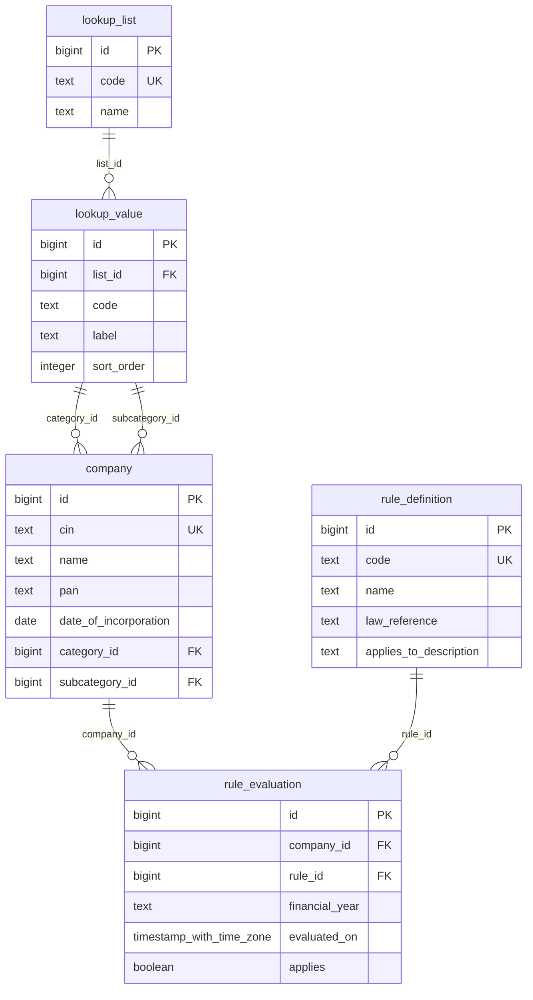
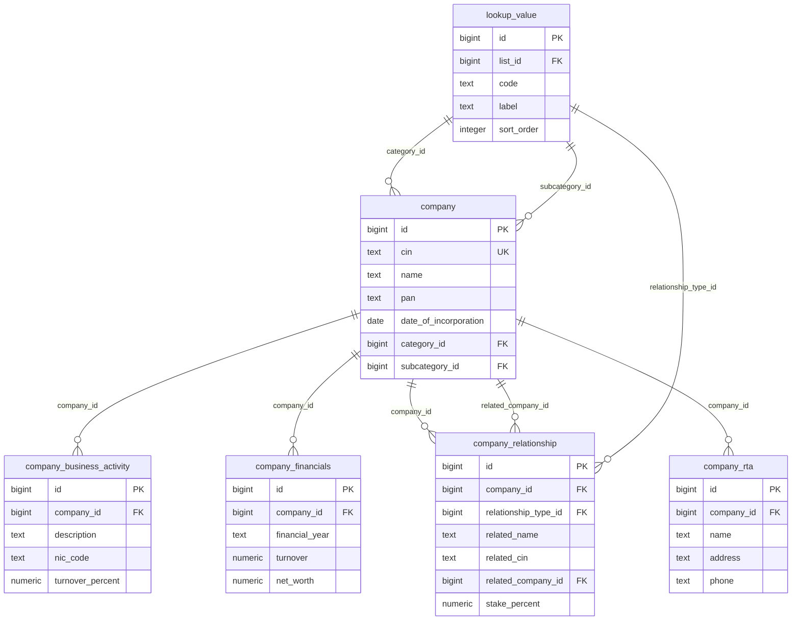
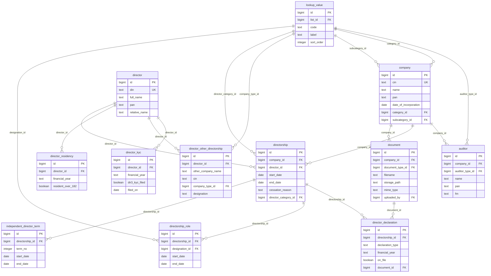
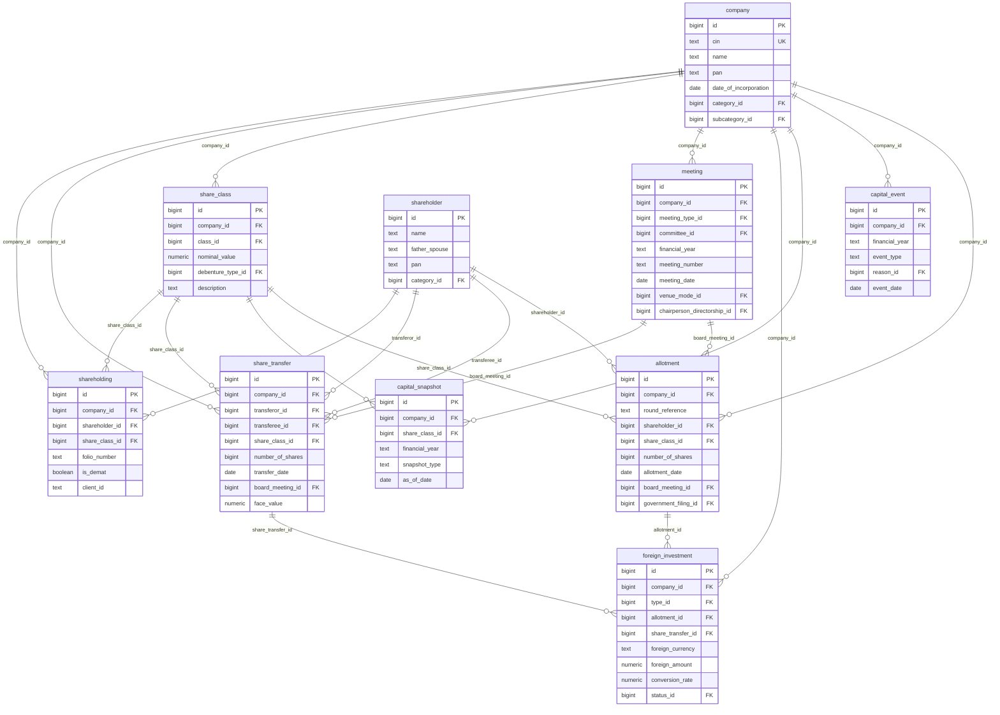
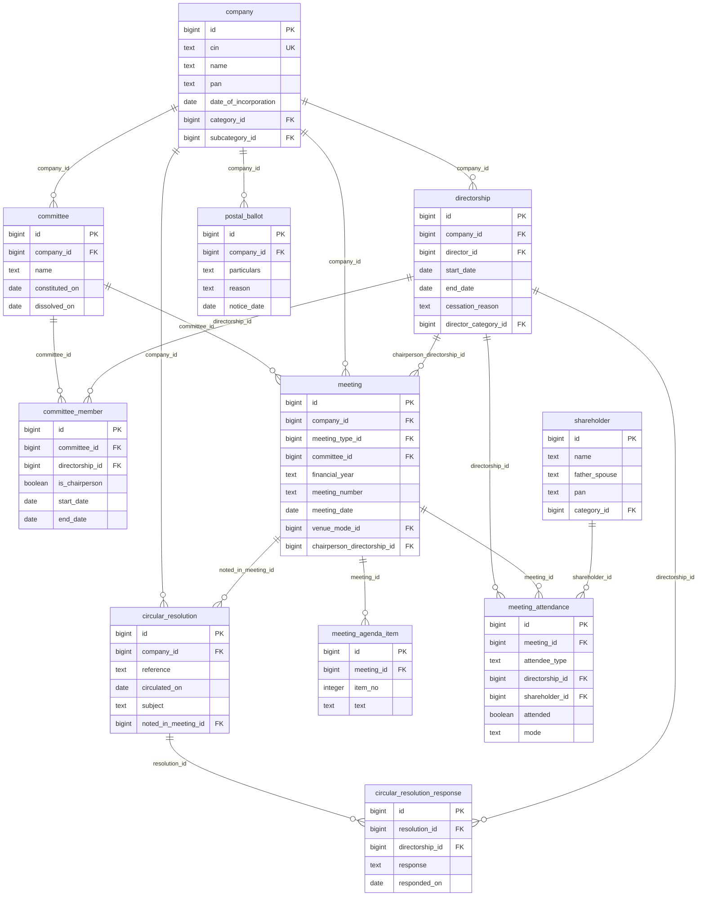
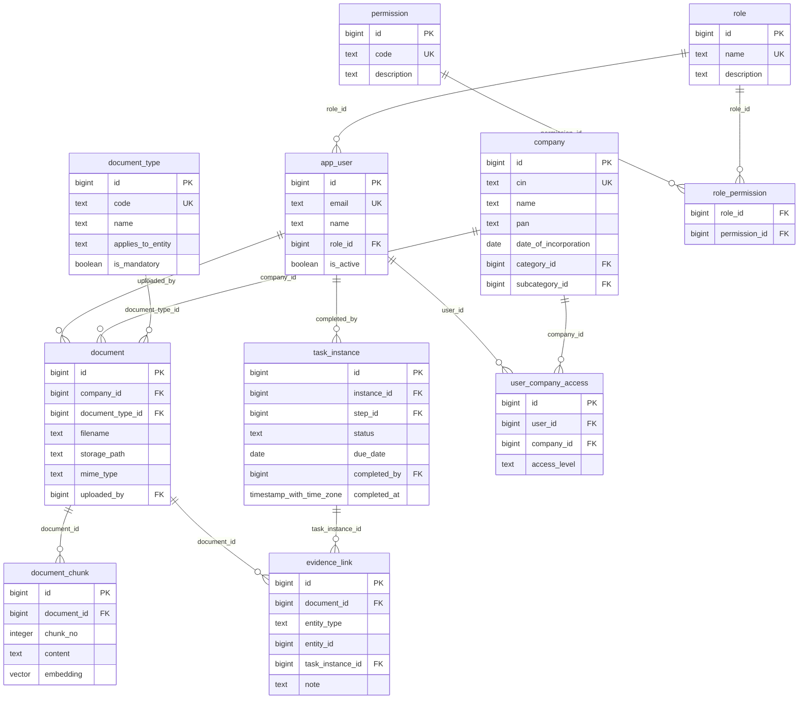
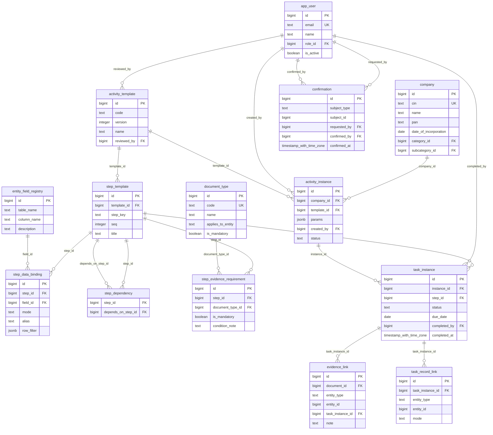

# Entity-Relationship Diagrams

Generated from the live PostgreSQL catalog (`pg_constraint`). `PK` = primary key, `FK` = foreign key, `UK` = unique key. Only key columns plus a few descriptive columns are drawn; see `DATA_DICTIONARY.md` for every column. Every relationship is `ON DELETE RESTRICT`.

Legend: `A ||--o{ B` means one A can have many B.

## Reference data and rules

## Company

## People, directors and auditors

## Capital and members

## Governance (meetings and committees)

## Financial, legal and filings

```mermaid
erDiagram
    company {
        bigint id PK
        text cin UK
        text name
        text pan
        date date_of_incorporation
        bigint category_id FK
        bigint subcategory_id FK
    }
    directorship {
        bigint id PK
        bigint company_id FK
        bigint director_id FK
        date start_date
        date end_date
        text cessation_reason
        bigint director_category_id FK
    }
    ecb {
        bigint id PK
        bigint company_id FK
        text lender_name
        text lender_country
        text lrn
        bigint status_id FK
    }
    government_filing {
        bigint id PK
        bigint company_id FK
        text form_name
        text description
        text financial_year
        bigint status_id FK
    }
    loan_deposit {
        bigint id PK
        bigint company_id FK
        text financial_year
        text borrowing_type
        numeric opening_principal
    }
    odi {
        bigint id PK
        bigint company_id FK
        text foreign_subsidiary_name
        text uin
        bigint shares_purchased
        bigint status_id FK
    }
    odi_step_down_subsidiary {
        bigint id PK
        bigint odi_id FK
        text name
        integer level
        text country
    }
    penalty_action {
        bigint id PK
        bigint company_id FK
        text relates_to
        bigint directorship_id FK
        bigint action_type_id FK
        text section
        text description
        bigint authority_id FK
    }
    portal_access {
        bigint id PK
        bigint company_id FK
        text portal_name
        text username
        text held_by
    }
    remuneration {
        bigint id PK
        bigint company_id FK
        text financial_year
        bigint directorship_id FK
        text person_name
        numeric salary
    }
    s185_loan {
        bigint id PK
        bigint company_id FK
        text beneficiary_description
        bigint directorship_id FK
        text loan_type
        numeric amount
        bigint board_meeting_id FK
    }
    s186_transaction {
        bigint id PK
        bigint company_id FK
        text financial_year
        text recipient_name
        text transaction_type
        bigint board_meeting_id FK
        bigint relationship_type_id FK
    }
    s188_related_party_txn {
        bigint id PK
        bigint company_id FK
        text financial_year
        text related_party_name
        bigint relationship_type_id FK
        bigint related_directorship_id FK
        text nature_of_txn
        bigint board_meeting_id FK
    }
    yearly_disclosure {
        bigint id PK
        bigint company_id FK
        text financial_year
        text disclosure_type
        jsonb details
        bigint dividend_type_id FK
    }
    company ||--o{ directorship : "company_id"
    company ||--o{ ecb : "company_id"
    company ||--o{ government_filing : "company_id"
    company ||--o{ loan_deposit : "company_id"
    company ||--o{ odi : "company_id"
    company ||--o{ penalty_action : "company_id"
    company ||--o{ portal_access : "company_id"
    company ||--o{ remuneration : "company_id"
    company ||--o{ s185_loan : "company_id"
    company ||--o{ s186_transaction : "company_id"
    company ||--o{ s188_related_party_txn : "company_id"
    company ||--o{ yearly_disclosure : "company_id"
    directorship ||--o{ penalty_action : "directorship_id"
    directorship ||--o{ remuneration : "directorship_id"
    directorship ||--o{ s185_loan : "directorship_id"
    directorship ||--o{ s188_related_party_txn : "related_directorship_id"
    odi ||--o{ odi_step_down_subsidiary : "odi_id"
```

## Documents, evidence and users

## Activity (definitions) and Ops (instances)

